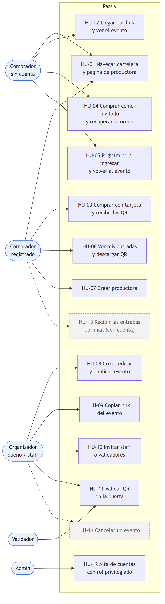

# Passly — Documentación funcional (historias de usuario)

> Entregable del Checkpoint 2 (PAS-28). Este documento describe **qué hace Passly**, no cómo
> está construido: la arquitectura está en `CLAUDE.md` y las integraciones en
> [integraciones.md](integraciones.md). La fuente es la *visión de producto* de CLAUDE.md §1
> (cinco recorridos acordados el 18/10). El estado de cada historia se relevó sobre `main` el
> **19/10/2026**, recorriéndola en la app real con los datos de demo.
>
> **Prototipo navegable (Figma):** [recorrido del comprador](https://www.figma.com/proto/aQFl7PEjpuIVy9DjmbPJ3W/Passly?node-id=4-3&starting-point-node-id=4%3A3)
> · [archivo de diseño](https://www.figma.com/design/aQFl7PEjpuIVy9DjmbPJ3W/Passly). Flujos de inicio: *Comprador — compra
> con tarjeta*, *Organizador — panel y eventos*, *Comprador — mobile* (página "Web — Passly") y *Validador — escaneo y
> resultados* (página "App - Passly"). El prototipo es de diseño: algunas pantallas del panel (ventas, reportes,
> configuración) muestran funciones que todavía no existen en la app; el estado real es el de la tabla de abajo.

**Estado:** ✅ implementada en `main` · 🟡 parcial · ⏳ planificada (sin código).

## 1. Actores

| Actor | Quién es | Cómo obtiene el acceso |
|---|---|---|
| **Comprador sin cuenta** | Alguien que llega a la cartelera o a un link y quiere comprar sin registrarse | Ninguno: navega y compra como invitado |
| **Comprador registrado** | Tiene cuenta; ve sus compras en un solo lugar | Registro público (siempre crea una cuenta de comprador) |
| **Organizador** (dueño o staff) | Trabaja para una productora: crea y publica sus eventos | Crea su productora (queda como dueño) o acepta una invitación como staff |
| **Validador** | Controla el ingreso en la puerta de los eventos de una productora | Invitación del dueño de la productora |
| **Admin** | Administra la plataforma | Cuenta de administrador |

Una persona puede tener varios roles a la vez. Un organizador también compra entradas, y alguien
puede ser staff en una productora y validador en otra. Lo que puede hacer **sobre las fiestas de
una productora** depende de su tarea en esa productora, no de su tipo de cuenta.

Fuente editable: [`diagramas/casos-de-uso.mmd`](diagramas/casos-de-uso.mmd).

## 2. Mapa: recorridos de la visión → historias

| Recorrido (CLAUDE.md §1) | Historias | Estado |
|---|---|---|
| 1. La productora crea, publica y comparte el link | HU-07, HU-08, HU-09, HU-10 | ✅ |
| 2. Comprador que llega por el link | HU-02, HU-05 | ✅ |
| 3. Comprador que entra sin link (cartelera) | HU-01 | ✅ |
| 4. Compra con pasarela integrada + QR | HU-03, HU-04, HU-06 | ✅ (HU-13 ⏳) |
| 5. Validación en el ingreso | HU-11 | ✅ |
| Administración | HU-12 | ✅ |

## 3. Historias de usuario

### HU-01 · Navegar la cartelera y la página de una productora — ✅ (PAS-17, PAS-26)

**Como** comprador (con o sin cuenta) **quiero** ver los próximos eventos de todas las
productoras, buscarlos y filtrarlos **para** elegir a cuál ir.

- [x] La cartelera muestra solo eventos **publicados**, con productora, fecha, lugar y precio "Desde".
- [x] Puedo buscar por nombre del evento o lugar, y filtrar por productora.
- [x] Cada productora tiene una página pública (`/productoras/{id}`) con su descripción y sus eventos.
- [x] Los borradores no aparecen en ningún listado público.

### HU-02 · Llegar por el link de un evento — ✅ (PAS-25)

**Como** comprador **quiero** abrir el link que compartió la productora y ver el evento en el
acto **para** comprar sin buscarlo.

- **Dado** el link de un evento publicado, **cuando** lo abro sin sesión, **entonces** veo el
  detalle con sus tipos de entrada, precios y disponibilidad, y puedo elegir cantidades.
- **Dado** el link de un evento en borrador, **cuando** lo abro sin poder gestionarlo,
  **entonces** veo "Este evento no existe o todavía no está publicado".
- **Dado** que soy organizador de esa productora, **cuando** abro un borrador, **entonces** veo
  una vista previa sin opción de comprar.

### HU-03 · Comprar con tarjeta y recibir los QR — ✅ (PAS-8, PAS-20, PAS-29, PAS-30)

**Como** comprador registrado **quiero** pagar con tarjeta y recibir una entrada con QR por
cada lugar **para** entrar al evento.

- **Dado** que elegí entradas, **cuando** voy al pago, **entonces** veo el resumen (evento,
  fecha, lugar, cantidades, total) y una cuenta regresiva de **5 minutos**.
- **Dado** una tarjeta aprobada, **cuando** pago, **entonces** se descuenta el cupo, se confirma
  la orden y veo **un QR por entrada**.
- **Dado** una tarjeta rechazada, **cuando** pago, **entonces** veo "El pago fue rechazado", no
  se cobra nada y conservo la selección para reintentar.
- **Dado** que la pasarela no responde, **cuando** pago, **entonces** veo un error de servicio no
  disponible y no se crea ninguna orden.
- **Dado** que pasaron los 5 minutos, **cuando** intento pagar, **entonces** el carrito vence y
  me ofrece volver a elegir. No se cobra nada.
- **Dado** que se agotó el cupo mientras elegía, **cuando** pago, **entonces** la compra no se
  confirma y el cobro se revierte. *El carrito no reserva cupo: se verifica al pagar.*
- [x] Los datos de la tarjeta no se guardan en ningún lado.

### HU-04 · Comprar como invitado y recuperar la orden — ✅ (18/10)

**Como** comprador sin cuenta **quiero** comprar dejando solo mi nombre y mi email **para** no
tener que registrarme.

- **Dado** que elegí entradas sin sesión, **cuando** completo nombre, email y tarjeta y pago,
  **entonces** veo mi orden con los QR y recibo un **mail con un enlace privado** a la orden.
- **Dado** que perdí el enlace, **cuando** ingreso el número de orden y el email en
  `/orden-invitado`, **entonces** recibo un enlace nuevo y el anterior deja de servir. La
  respuesta en pantalla es la misma coincida o no, para no revelar órdenes ajenas.
- [x] El enlace vence 30 días después del último evento de la compra.

### HU-05 · Registrarse o ingresar sin perder lo que estaba haciendo — ✅ (PAS-15, PAS-25)

**Como** comprador que llegó por un link **quiero** crear una cuenta o ingresar en medio de la
compra **para** seguir donde estaba.

- **Dado** que elegí entradas como invitado, **cuando** toco "Ingresar y continuar con mi
  cuenta", **entonces** después de ingresar vuelvo a mi selección, sin duplicar cantidades.
- **Dado** que me registro desde un evento, **cuando** termino el alta, **entonces** vuelvo a ese
  evento con la sesión iniciada.
- [x] El registro público siempre crea una cuenta de **comprador**: nadie puede darse otros
  permisos al registrarse.

### HU-06 · Ver mis entradas y descargar los QR — ✅ (PAS-18, PAS-20)

**Como** comprador registrado **quiero** ver todas mis compras **para** tener mis entradas a mano
el día del evento.

- [x] "Mis entradas" separa las compras de eventos **próximos** y **pasados**.
- [x] Cada orden muestra sus entradas con QR, categoría, precio y código.
- [x] Cada QR se puede **descargar** como imagen y tiene un contenido alternativo para ingreso manual.
- [x] Solo veo mis propias órdenes. Una orden ajena responde "no encontrada", sin revelar que existe.

### HU-07 · Crear mi productora — ✅ (PAS-13, PAS-16, 18/10)

**Como** persona que organiza fiestas **quiero** crear mi productora **para** publicar eventos
con su nombre.

- **Dado** que tengo cuenta, **cuando** completo el nombre comercial (y, opcionalmente, CUIT,
  descripción y logo), **entonces** la productora queda creada, soy su **dueño** y llego a su
  resumen con el paso siguiente: crear mi primer evento.

### HU-08 · Crear, editar y publicar un evento — ✅ (PAS-12, PAS-17, PAS-19)

**Como** organizador **quiero** cargar un evento con sus tipos de entrada y cupos, revisarlo y
publicarlo **para** ponerlo a la venta.

- **Dado** que soy dueño o staff, **cuando** guardo un evento nuevo, **entonces** queda en
  **borrador**, invisible al público.
- **Dado** un borrador, **cuando** lo edito, **entonces** puedo cambiar todo: datos, precios y cupos.
- **Dado** un borrador, **cuando** elijo "Revisar y publicar", **entonces** veo un resumen y las
  consecuencias, y recién al confirmar aparece en la cartelera.
- **Dado** un evento **publicado**, **cuando** intento cambiar nombre, fecha, lugar o una
  categoría existente, **entonces** no se permite: solo puedo **sumar cupo** o **agregar
  categorías**, nada que perjudique a quien ya compró.
- **Dado** que soy validador u organizador de **otra** productora, **cuando** intento gestionar
  el evento, **entonces** se rechaza.

### HU-09 · Compartir el link de mi evento — ✅ (PAS-25)

**Como** organizador **quiero** copiar el link público de un evento **para** difundirlo en redes
o por WhatsApp.

- [x] La gestión del evento tiene **"Copiar enlace público"**, que copia la URL del detalle.
- [x] Quien abre ese link entra a la HU-02.

### HU-10 · Sumar staff y validadores a mi productora — ✅ (PAS-16, 18/10)

**Como** dueño de una productora **quiero** invitar personas por email como **staff** o
**validador** **para** repartir el trabajo sin compartir mi cuenta.

- **Dado** que soy dueño, **cuando** invito un email con una tarea, **entonces** esa persona
  recibe un mail con un enlace que dura **7 días** y sirve **una sola vez**.
- **Dado** el enlace, **cuando** la persona lo acepta con la cuenta de ese email, **entonces**
  pasa a figurar en "Integrantes" con su tarea.
- [x] Puedo ver el estado de cada invitación, reenviarla (invalida la anterior) o revocarla.
- [x] Staff gestiona eventos. El validador solo controla el ingreso. Solo el dueño invita.

### HU-11 · Validar entradas en la puerta — ✅ (PAS-31)

**Como** validador de una productora **quiero** escanear el QR de cada entrada **para** dejar
pasar solo entradas válidas, una vez cada una.

- **Dado** que elegí el evento, **cuando** escaneo un QR válido sin usar, **entonces** veo
  **VÁLIDO** (verde) y la entrada queda marcada como usada.
- **Dado** un QR que ya se usó, **cuando** lo escaneo, **entonces** veo **YA USADO** (amarillo) y
  la hora del primer ingreso.
- **Dado** un QR de otro evento, **cuando** lo escaneo, **entonces** veo **OTRO EVENTO**.
- **Dado** un QR adulterado o inventado, **cuando** lo escaneo, **entonces** veo **INVÁLIDO** (rojo).
- **Dado** que dos validadores escanean la misma entrada a la vez, **entonces** solo uno ve VÁLIDO.
- [x] Funciona con la cámara del celular o con ingreso manual si no hay cámara.
- [x] Solo puedo validar eventos de las productoras donde tengo esa tarea.
- 🟡 Hoy es una pantalla **web** adaptada a celular. La app móvil nativa está planificada.

### HU-12 · Dar de alta cuentas con permisos especiales — ✅ (PAS-6, PAS-15)

**Como** admin **quiero** crear cuentas de organizador, validador o admin **para** gestionar la
plataforma sin que nadie se autoasigne permisos.

- [x] Desde "Mi perfil", un admin ve el formulario "Alta de usuario" con la elección de rol.
- [x] Otra cuenta que intente crear un usuario con rol privilegiado es rechazada.
- [x] Solo un admin puede listar todos los usuarios.

### HU-13 · Recibir mis entradas por mail con una cuenta registrada — ⏳ planificada

**Como** comprador registrado **quiero** recibir un mail con mis entradas al comprar **para** no
depender de entrar a la web.

- Hoy el mail con enlace se envía **solo en la compra como invitado** (HU-04). Con cuenta, las
  entradas se ven en "Mis entradas".
- Llega con el tópico `ticket.emitido` y el servicio de notificaciones (Obligatoria 2, ver
  [integraciones.md](integraciones.md) §3.1 E6).

### HU-14 · Cancelar un evento — ⏳ planificada (sin issue)

**Como** organizador **quiero** cancelar un evento publicado **para** avisar a los compradores y
dejar de venderlo.

- El estado `CANCELADO` existe en el modelo y la pantalla de detalle sabe mostrarlo, pero **no
  hay ninguna operación que cancele** ni política de reintegro. Queda fuera del alcance de los
  cinco recorridos de la visión y está registrado como pendiente en Linear.

## 4. Reglas de negocio transversales

| Regla | Dónde se ve |
|---|---|
| El carrito dura **5 minutos** desde que se crea y **no reserva cupo** | HU-03, HU-04 |
| Una entrada = un QR firmado, válido **una sola vez** | HU-03, HU-11 |
| Un evento publicado solo admite cambios que **amplían** (más cupo, más categorías) | HU-08 |
| Lo que alguien puede hacer en una productora depende de su **tarea en esa productora** | HU-08, HU-10, HU-11 |
| No se guardan datos de tarjeta | HU-03, HU-04 |
| La factura se genera después de confirmar la venta y nunca la frena | [integraciones.md](integraciones.md) §5 |
