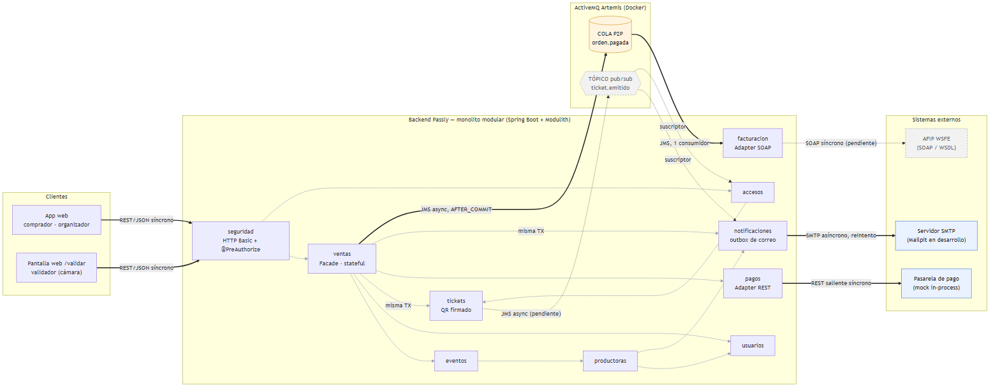

# Integraciones de Passly — arquitectura SOA y clasificación síncrona / asíncrona

> Entregable del Checkpoint 2 (PAS-27). Estado relevado sobre `main` el **19/10/2026**,
> después de mergear PAS-29, PAS-30, PAS-31 y PAS-32. Cada fila marcada como *implementada*
> se contrastó con el código. Lo que todavía no existe figura como *pendiente* y no se
> presenta como hecho.

## 1. Forma del sistema

Passly es **un backend modular y un cliente web**, más un broker de mensajería y tres
sistemas externos:

- **Backend.** Un único artefacto Spring Boot con diez módulos (nueve de negocio más
  `seguridad`). Spring Modulith verifica sus fronteras en cada build. Dentro del backend, los
  módulos se llaman **en proceso** a través de sus interfaces públicas. Entre procesos se usa
  **REST**, **SOAP** o **JMS**.
- **Clientes.** La app web (React + Vite) atiende al comprador y al organizador. La validación
  en puerta hoy también es web (`/validar`, con cámara del dispositivo e ingreso manual,
  PAS-31). La app móvil del validador sigue planificada y usaría el mismo endpoint REST.
- **Broker.** ActiveMQ Artemis en Docker, con una cola durable (`orden.pagada`, implementada) y
  un tópico (`ticket.emitido`, pendiente).
- **Externos.** La pasarela de pago (REST), AFIP (SOAP/WSDL, pendiente) y un servidor SMTP
  (Mailpit en desarrollo).

## 2. Diagrama de integración

La fuente editable es [`diagramas/integracion-soa.mmd`](diagramas/integracion-soa.mmd)
(Mermaid). El PNG y el SVG se regeneran desde ese archivo con el comando de su encabezado.
Nunca se editan a mano.

**Cómo leerlo:**

| Trazo | Significado |
|---|---|
| Línea negra gruesa | Integración entre procesos, **implementada** (REST, SMTP o JMS) |
| Línea gris fina | Llamada **en proceso** entre módulos, síncrona y verificada por Spring Modulith |
| Línea punteada, nodo gris | **Pendiente**: diseñada pero sin código en `main` |
| Cilindro | Cola punto a punto (un consumidor) |
| Hexágono | Tópico publicar/suscribir (N suscriptores) |
| "misma TX" | La llamada se une a la transacción declarativa de la compra (`REQUIRED`) |

## 3. Inventario de integraciones

### 3.1 Entre procesos: clientes, broker y externos

| # | Origen → Destino | Canal | Sync / Async | Estado | Justificación |
|---|---|---|---|---|---|
| E1 | App web → backend (`/api/**`) | REST/JSON sobre HTTP. Basic + cookie de sesión del carrito, CORS | **Síncrona** | Implementada (PAS-6, PAS-14 a PAS-18, PAS-25/26/30) | El usuario espera la respuesta en pantalla: ver la cartelera, agregar al carrito o confirmar una compra. No hay nada que diferir. |
| E2 | Validador → Accesos (`POST /api/accesos/validaciones`) | REST/JSON, `@PreAuthorize` VALIDADOR / ORGANIZADOR / ADMIN | **Síncrona** | Implementada (PAS-31), cliente web `/validar` | En la puerta hace falta un "pasa / no pasa" inmediato, y el marcado como usado es atómico. Una respuesta diferida permitiría que la misma entrada entrara dos veces. |
| E3 | Pagos → pasarela de pago | REST saliente (`RestClient`, HTTP real) contra el mock `/mock/pasarela-pago/**` | **Síncrona** | Implementada (PAS-7). Ventas la usa desde PAS-29 | Sin cobro aprobado no se emite la entrada: la compra necesita la respuesta para seguir. Por eso queda **fuera** de la transacción (ver §5). Cambiar de proveedor es cambiar `passly.pagos.pasarela.base-url`. |
| E4 | Ventas → Facturación | **Cola JMS P2P** `orden.pagada` (Artemis, durable) | **Asíncrona** | Implementada (PAS-32) | Facturar no condiciona la venta: la orden ya está confirmada. Un solo consumidor, porque una orden no se factura dos veces (§4). |
| E5 | Facturación → AFIP (WSFE) | SOAP / WSDL (Spring WS + JAXB) | **Síncrona** dentro del consumidor | **Pendiente**. Hoy solo existe el puerto `ClienteAfip` con un adapter que registra en el log (`ClienteAfipPendiente`). Las facturas quedan `PENDIENTE_AFIP` | AFIP devuelve el CAE en la misma respuesta, así que la llamada es síncrona. Pero ocurre **dentro** del consumidor de la cola, nunca dentro de la compra, y lo asíncrono es el tramo Ventas → Facturación. |
| E6 | Tickets → Notificaciones + Accesos (+ métricas) | **Tópico JMS** `ticket.emitido` | **Asíncrona** | **Pendiente** (Obligatoria 2). Hoy Accesos consulta a Tickets en proceso | Varios interesados independientes en el mismo hecho (§4). Ninguno debe frenar la emisión. |
| E7 | Notificaciones → servidor SMTP | SMTP saliente desde un worker `@Scheduled` | **Asíncrona** | Implementada (invitaciones y compra como invitado, 18/10) | El correo se guarda en `notificaciones.correo` dentro de la transacción que lo origina y sale después, con reintento y espera creciente. Un SMTP caído no deshace una compra (§6). |

### 3.2 En proceso, entre módulos del backend

Todas son **síncronas**: llamadas Java a la interfaz pública del módulo destino, con
dependencias declaradas en el `package-info.java` de cada módulo y verificadas por
`EstructuraDeModulosTest`. Si un módulo importa el `internal` de otro o usa una dependencia no
declarada, **el build falla**.

| # | Origen → Destino | Para qué | Estado | Justificación de que sea síncrona |
|---|---|---|---|---|
| I1 | Ventas → Eventos | Consultar disponibilidad y precio; `descontarCupo` | Implementada (PAS-8) | El descuento de cupo y el alta de la orden tienen que confirmarse juntos: comparten la transacción (propagación `REQUIRED`). |
| I2 | Ventas → Usuarios | Datos del comprador en la orden | Implementada (PAS-8) | Lectura necesaria para armar la orden. Sin efectos a diferir. |
| I3 | Ventas → Tickets | Emitir un ticket con QR firmado por unidad | Implementada (PAS-20) | Una orden confirmada sin sus tickets sería un estado inválido. Se emiten en la **misma** transacción. |
| I4 | Ventas → Pagos | Cobrar y revertir, detrás del puerto `PasarelaDePago` (`PasarelaDePagoReal`) | Implementada (PAS-29) | El resultado del cobro decide si se confirma la compra. |
| I5 | Ventas → Notificaciones | Encolar el correo de la orden (compra como invitado) | Implementada (18/10) | Es un `INSERT` en la misma transacción, así que el correo existe si y solo si la compra se confirmó. El envío real es asíncrono (E7). |
| I6 | Eventos → Productoras | ¿Quién opera puede gestionar esta productora? Nombre comercial para la cartelera | Implementada (PAS-13) | Es una verificación de autorización: tiene que responder antes de dejar crear, editar o publicar. |
| I7 | Productoras → Usuarios | Identidad y rol global al incorporar o invitar un miembro | Implementada (PAS-13) | Invariante que se verifica una sola vez, en el alta del miembro. |
| I8 | Productoras → Notificaciones | Encolar el correo de invitación | Implementada (18/10) | Igual que I5: un registro transaccional y un envío asíncrono. |
| I9 | Accesos → Tickets / Eventos / Productoras | Verificar la firma, la pertenencia del ticket a la productora del validador y el uso único atómico | Implementada (PAS-31) | Tiene que contestar en el acto (E2). |
| I10 | Seguridad → Usuarios | Autenticar contra `usuarios :: autenticacion` (`CredencialDTO`) | Implementada (PAS-6) | Cada request se autentica antes de ejecutarse. |

**Facturación no depende de Ventas en el grafo de módulos** (`allowedDependencies = {}`). La
dependencia de negocio existe, pero es asíncrona (E4) y no se traduce en una arista Java: el
consumidor deserializa el JSON a un `record` propio y no importa ninguna clase de `ventas`.

## 4. Por qué cola y no tópico, y por qué tópico y no cola

> Este apartado está escrito para leerse en voz alta en la defensa.

**`orden.pagada` es una cola** porque responde a la pregunta *"¿quién tiene que hacer este
trabajo?"*, y la respuesta es **uno solo**. Una orden pagada se factura exactamente una vez. En
una cola punto a punto, cada mensaje lo consume **un único** receptor, aunque haya varias
instancias de Facturación escuchando para repartirse la carga. Si fuera un tópico, cada
suscriptor recibiría su propia copia, y dos instancias de Facturación emitirían dos facturas
por la misma venta. Además, la cola es **durable**: si Facturación está caída, los mensajes se
acumulan y se procesan cuando vuelve. Eso es exactamente lo que se quiere de un trabajo que
*tiene* que hacerse aunque se haga tarde.

**`ticket.emitido` es un tópico** porque responde a otra pregunta: *"¿quién quiere enterarse
de que esto pasó?"*. La respuesta es **varios, que no se conocen entre sí**: Notificaciones
manda la entrada por mail, Accesos precarga lo necesario para validar en puerta y, más
adelante, las métricas del organizador. Cada uno hace algo distinto con el mismo hecho. Con un
tópico, Tickets publica **una vez** y no sabe quién escucha. Sumar un suscriptor nuevo no toca
a Tickets ni a los demás. Con una cola, los suscriptores competirían por el mensaje: si
Notificaciones se lo llevara, Accesos nunca se enteraría.

**La regla en una frase:** cola cuando el mensaje es una **orden de trabajo** que debe hacerse
una vez; tópico cuando es un **aviso de un hecho** que interesa a varios.

## 5. Por qué la factura sale por cola y el cobro queda fuera de la transacción

La compra tiene un límite transaccional declarativo (`ConfirmacionDeCompra.confirmar`):
descontar cupo, registrar la orden, emitir los tickets y, en la compra como invitado, encolar el
correo con el enlace privado. O todo, o nada. Dos
llamadas a externos quedan **fuera** de ese límite a propósito:

- **El cobro (E3)** ocurre *antes* de abrir la transacción, en `VentaServiceImpl`, que por eso
  no lleva `@Transactional` de clase. Una llamada HTTP lenta dentro de la transacción mantendría
  bloqueadas las filas de `eventos.tipo_entrada` mientras la pasarela responde. Además, un cobro
  no se deshace con un `ROLLBACK`. Si la transacción falla después de cobrar, se **compensa**
  explícitamente con `PasarelaDePago.revertir`.
- **La factura (E4 + E5)** sale *después* del commit (`@TransactionalEventListener(AFTER_COMMIT)`
  en `PublicadorDeOrdenPagada`). Si saliera dentro, un rollback ya habría anunciado una venta
  que no existe. Llamar a AFIP de forma síncrona dentro de la compra tendría los dos problemas
  del cobro: filas bloqueadas y un efecto no reversible, más la lentitud conocida de AFIP.

## 6. Qué pasa si un externo se cae

| Falla | Qué ve el usuario | Qué pasa con los datos |
|---|---|---|
| **Pasarela no responde** | **503** (`PasarelaDePagoNoDisponibleException`), distinto del **402** de un rechazo de negocio (`PagoRechazadoException`) | No se abre la transacción: ni cupo descontado ni orden. El **carrito queda intacto** para reintentar. En la compra como invitado, un estado ambiguo bloquea un nuevo cobro con la misma `Idempotency-Key` hasta conciliar. |
| **La compra falla después de cobrar** (por ejemplo, falta de cupo) | Error de la compra | Rollback completo y **compensación** del cobro (`revertir`). Si la reversión también fallara, el cobro queda huérfano con un log `ERROR`. Es una deuda declarada en CLAUDE.md §10. |
| **Facturación o AFIP caídos** | Nada: **la venta ya está confirmada** | El mensaje espera en la cola durable `orden.pagada`. Al volver, se consume. Si el consumo falla, Artemis reintenta (3 entregas con 5 s de demora) y después lo manda a la **DLQ**. La inserción es idempotente (restricción única + `ON CONFLICT`), así que un reintento no duplica facturas. |
| **Broker caído en el momento de publicar** | Nada: la venta ya está confirmada | `PublicadorDeOrdenPagada` registra `ERROR` con el id de la orden y no propaga la falla: no debe revertir un pago de una orden válida. **Límite honesto:** no hay outbox entre el commit y el envío JMS, así que ese mensaje se pierde y se concilia a mano. |
| **SMTP caído** | Nada: la compra o la invitación se confirman igual | El correo queda en `notificaciones.correo` y el worker lo reintenta con espera creciente (hasta 1 h). Si el proceso cae justo después de enviar, el mail puede llegar dos veces. |

## 7. Detalle de la cola `orden.pagada` (PAS-32)

- **Mensaje:** `TextMessage` persistente con JSON `{idOrden, idComprador, total, cobradaEn,
  compradorNombre, compradorEmail}`. `idComprador` es nulo en las compras como invitado. No
  lleva nombres de clases Java en los headers, así que emisor y consumidor no comparten tipos.
- **Consumo:** `OrdenPagadaListener` usa la sesión JMS transaccional. El ACK llega después del
  commit de `FacturacionService.registrarOrdenPagada`. Una caída entre el commit y el ACK puede
  redistribuir el mensaje, y por eso la inserción es idempotente aun con consumidores
  concurrentes.
- **Garantía:** entrega *al menos una vez* con efecto idempotente. No se promete exactly-once de
  transporte.
- **Configuración:** `infra/artemis/broker.xml` (cola durable, redelivery, DLQ) y
  `docker-compose.yml`. El guion de la demo (acumulación, reactivación, duplicado y DLQ) está en
  [mensajeria.md](mensajeria.md).

## 8. Pendientes: actualizar este documento cuando se mergeen

- [x] Ventas cobra con el `ServicioDePagos` real (PAS-29)
- [x] Validación en puerta con uso único (PAS-31)
- [x] Cola `orden.pagada` en Artemis (PAS-32)
- [ ] Tópico `ticket.emitido`: pasar E6 a *implementada*, dibujarla con línea continua y revisar
      si Accesos deja de consultar a Tickets en proceso (I9)
- [ ] Adapter SOAP hacia AFIP: pasar E5 a *implementada* y reemplazar `ClienteAfipPendiente`
- [ ] App móvil del validador: agregarla como cliente de E2
- [ ] Outbox para `orden.pagada`, si se implementa: actualizar la fila "Broker caído" de §6

Al cambiar un estado, actualizar **la tabla, el `.mmd` (y regenerar el PNG/SVG) y el PDF de
`entrega-c2/`** en el mismo commit.
