# Manual de usuario de Passly

Passly es una plataforma para **comprar entradas** a eventos y para que las **productoras** los
publiquen y controlen el ingreso. Este manual tiene una sección por tipo de usuario: buscá la que
te corresponde.

> Las capturas son de la app real con datos de ejemplo (Aurora Producciones, Nocturna Live y sus
> eventos). Los pagos de este entorno son de prueba: **no se cobra dinero real**.

**Contenido**

1. [Para quien compra entradas](#1-para-quien-compra-entradas)
2. [Para quien organiza eventos](#2-para-quien-organiza-eventos)
3. [Para quien controla el ingreso](#3-para-quien-controla-el-ingreso)
4. [Para el administrador](#4-para-el-administrador)
5. [Problemas frecuentes](#5-problemas-frecuentes)

---

## 1. Para quien compra entradas

### 1.1 Encontrar un evento

1. Entrá a Passly. La pantalla inicial es la **cartelera**, con los próximos eventos de todas las
   productoras.
2. Para encontrar uno, escribí el nombre o el lugar en **Buscar**, o elegí una **Productora**.
3. Tocá **Ver entradas** en el evento que te interese.

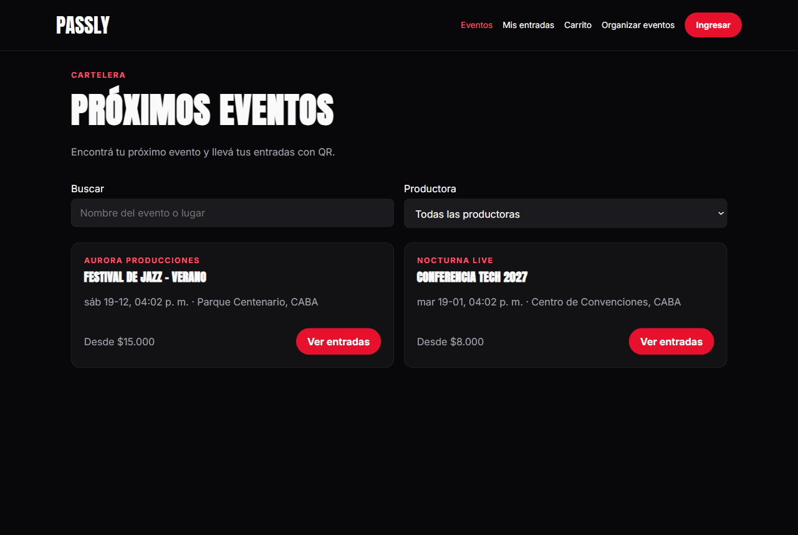

Si te pasaron el **link** de un evento, al abrirlo llegás directo a su página. Desde el nombre
de la productora podés ver su página, con todos sus eventos:

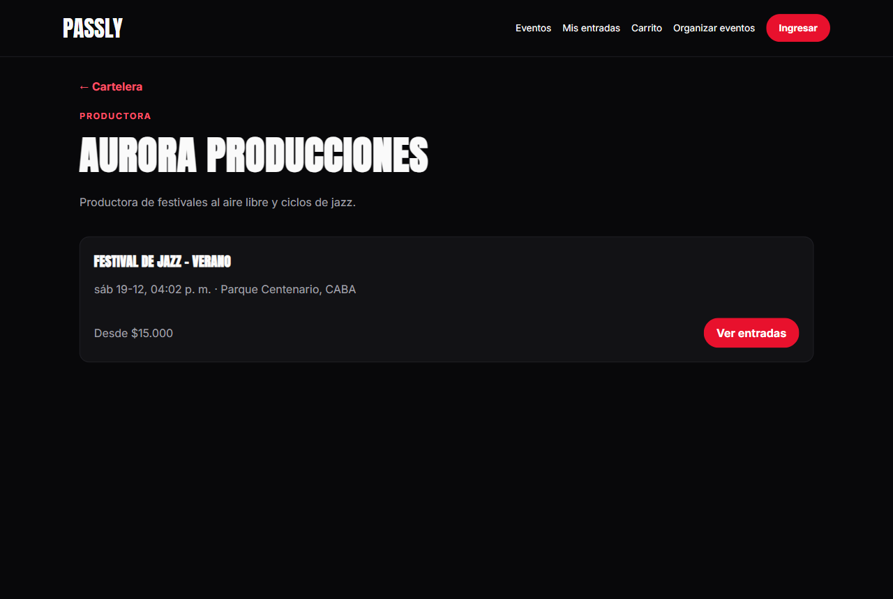

### 1.2 Comprar una entrada

1. En la página del evento, usá **+** y **−** para elegir cuántas entradas querés de cada tipo
   (por ejemplo, General o VIP). Abajo ves el total.
2. Tocá **Continuar al pago**. Si no ingresaste a tu cuenta, el botón dice **Continuar como
   invitado** (ver 1.3).

   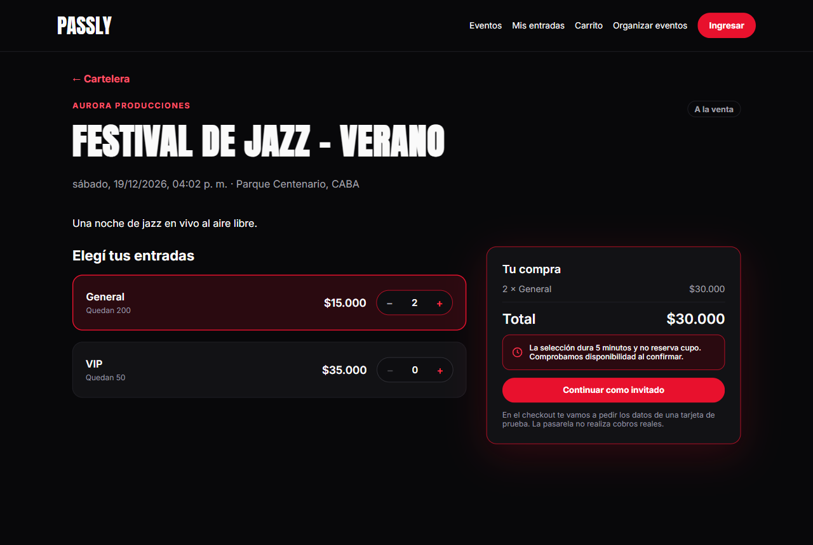

3. En **Datos y pago**, revisá el resumen de la derecha y completá los datos de la tarjeta:
   número, titular, vencimiento y código de seguridad.
4. Tocá **Pagar**. Arriba ves cuánto tiempo te queda: **tenés 5 minutos** para completar el pago.

   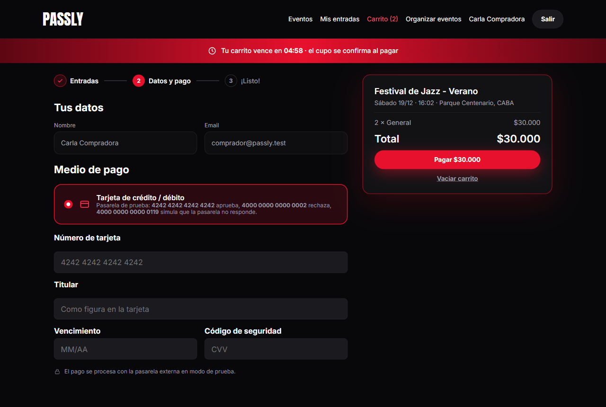

5. Listo: aparece **Compra confirmada** con **un código QR por cada entrada**.

   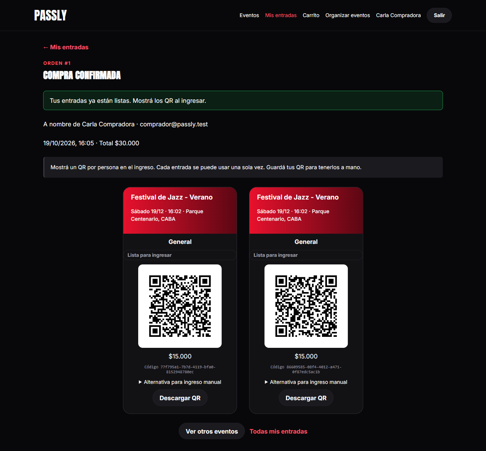

> **Importante:** elegir entradas **no las reserva**. Si se agotan mientras pagás, la compra no
> se confirma y no se te cobra.

### 1.3 Comprar sin crear una cuenta

1. Elegí tus entradas y tocá **Continuar como invitado**.
2. Completá tu **nombre** y tu **email**, y después los datos de la tarjeta.
3. Al pagar, ves tus entradas en pantalla y además te llega un **mail con un enlace privado** a tu
   compra. Guardalo: es la forma de volver a ver tus QR.

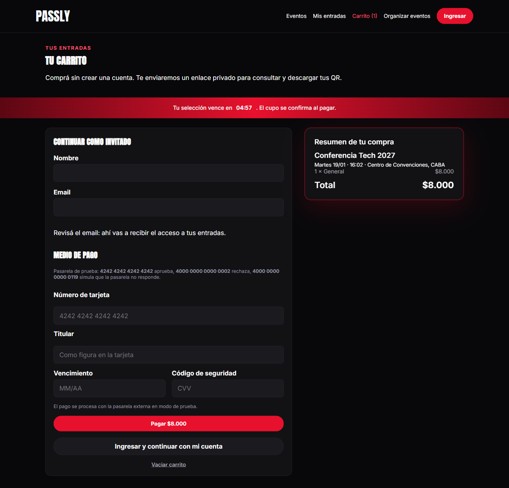

¿Preferís usar tu cuenta? Tocá **Ingresar y continuar con mi cuenta**. Después de ingresar,
volvés a tu compra con las mismas entradas elegidas.

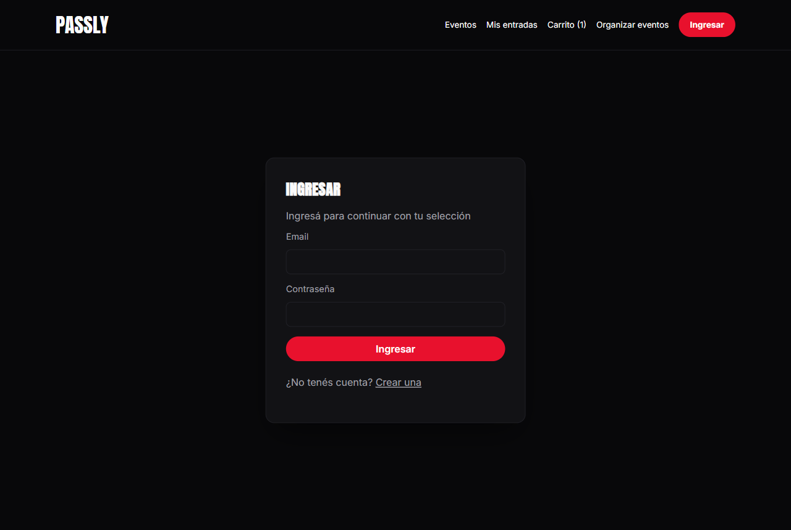

### 1.4 Crear una cuenta

1. Tocá **Ingresar** y después **Crear una**.
2. Completá nombre, email y contraseña.
3. Si venías de un evento, volvés a ese evento con la sesión iniciada.

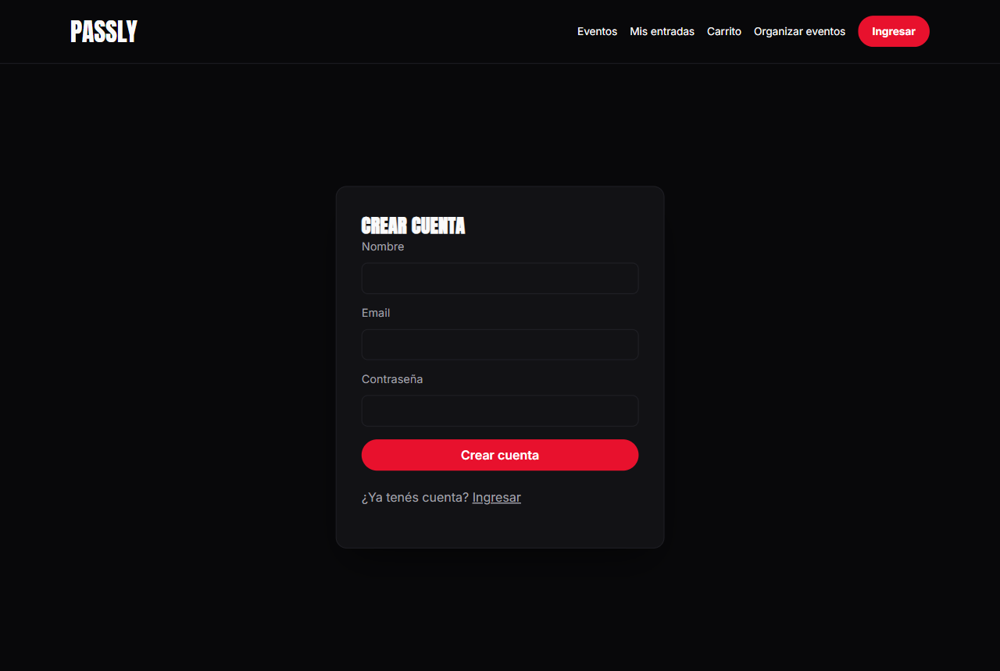

### 1.5 Dónde ver mis entradas y los QR

1. Tocá **Mis entradas** en el menú.
2. Tus compras están separadas en **Próximas** y **Pasadas**. Tocá una para ver sus entradas.
3. Cada entrada tiene su QR. Con **Descargar QR** lo guardás como imagen en el celular.
4. En la puerta, **mostrá un QR por persona**. Cada uno sirve para entrar **una sola vez**.

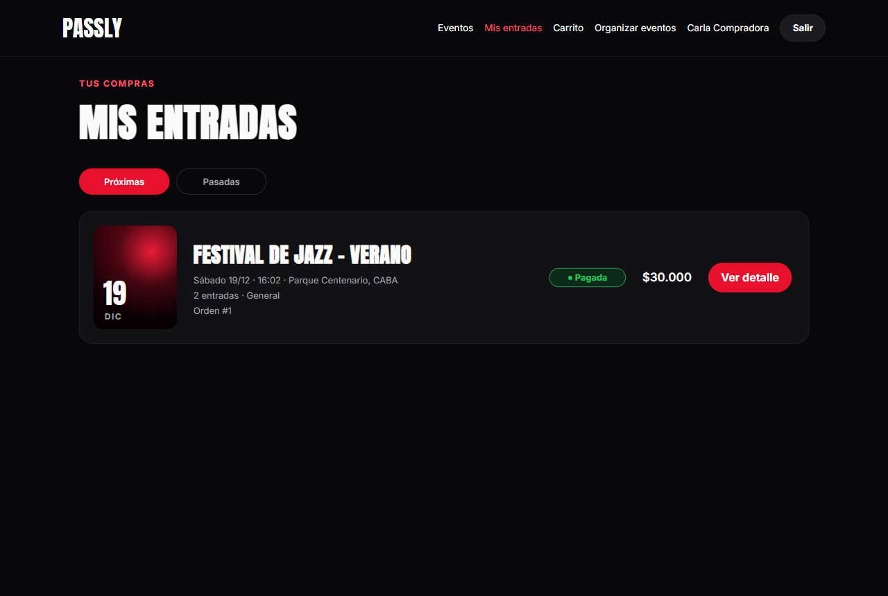

Si compraste como invitado y perdiste el mail, entrá a **Mis entradas** sin iniciar sesión, ingresá el número de
orden y el email de la compra, y te mandamos un enlace nuevo. El anterior deja de funcionar.

---

## 2. Para quien organiza eventos

### 2.1 Crear tu productora

1. Tocá **Organizar eventos** → **Crear mi productora**. Si no tenés cuenta, te pide crear una o
   ingresar, y después volvés al formulario.
2. Completá el **nombre comercial**. CUIT, descripción y logo son opcionales.
3. Al guardar, quedás como **dueño** y llegás al **Resumen** de tu productora.

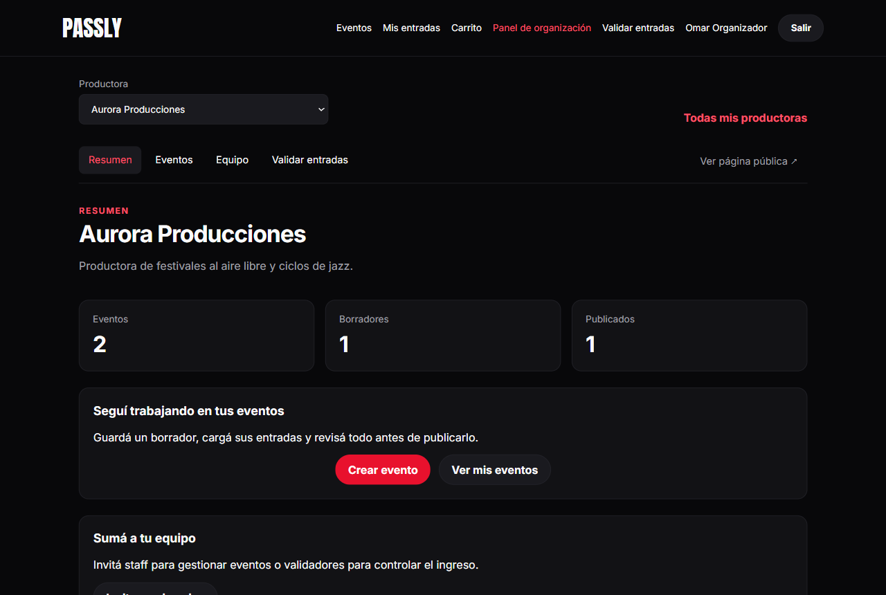

Si ya tenés una productora, entrás desde **Panel de organización**. Arriba podés cambiar de
productora si trabajás en más de una.

### 2.2 Crear un evento

1. En tu productora, entrá a **Eventos** → **Crear evento**.
2. Completá nombre, descripción, fecha y hora, y lugar.
3. Agregá al menos un **tipo de entrada**, con nombre, precio y cantidad disponible (cupo).
4. Tocá **Guardar borrador**. El evento queda guardado pero **todavía no se ve en la cartelera**.

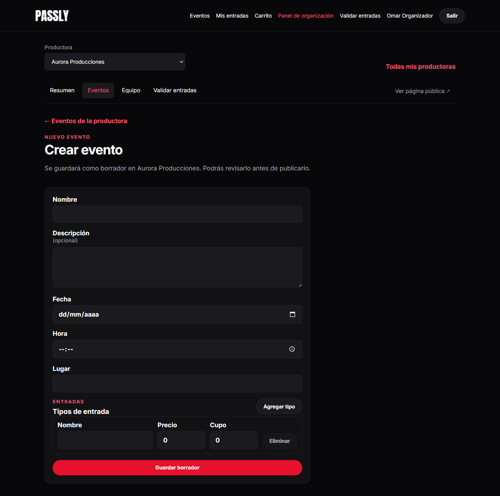

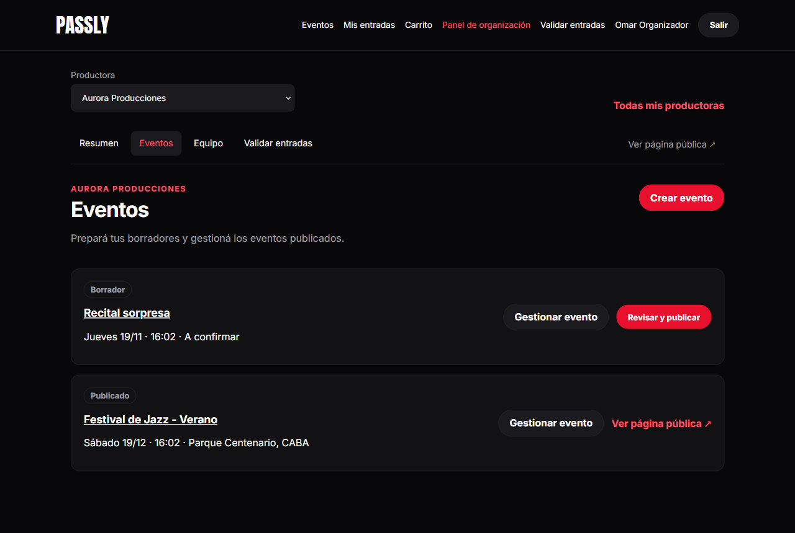

### 2.3 Revisar y publicar

1. Abrí el borrador. Podés **Editar evento** las veces que quieras, o mirar la **Vista previa**
   para verlo como lo va a ver el público.
2. Cuando esté listo, tocá **Revisar y publicar**.
3. Revisá los datos y tocá **Publicar evento**. Desde ese momento aparece en la cartelera y se
   pueden comprar entradas.

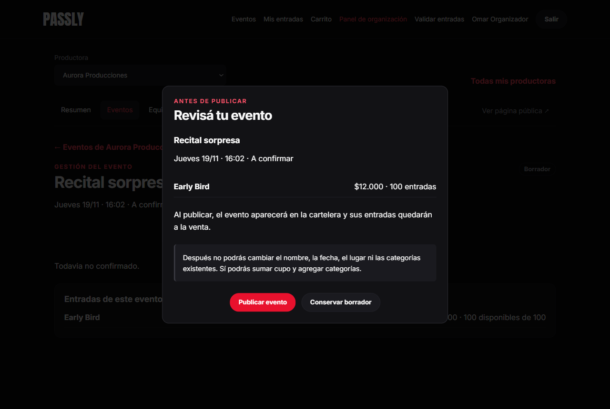

> **Después de publicar** ya no podés cambiar el nombre, la fecha, el lugar ni los tipos de
> entrada existentes, para no perjudicar a quien ya compró. **Sí podés** sumar más cupo o
> agregar tipos de entrada nuevos.

### 2.4 Compartir el link de tu evento

1. Abrí el evento publicado desde **Eventos**.
2. Tocá **Copiar enlace público**.
3. Pegalo donde quieras: Instagram, WhatsApp, un mail. Quien lo abra llega directo a la compra.

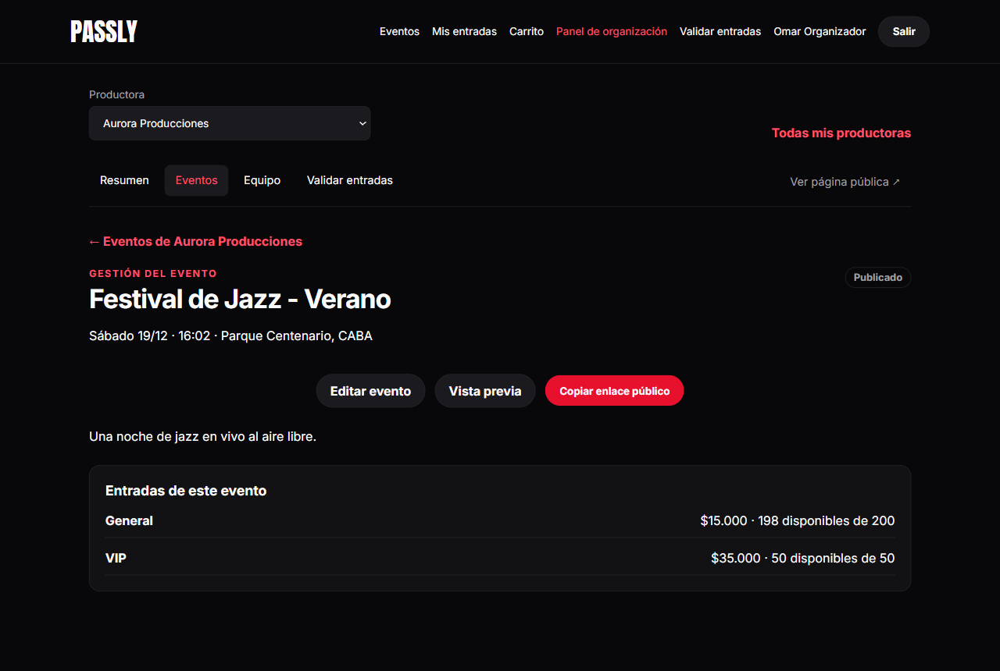

### 2.5 Sumar personas a tu productora

Solo el **dueño** puede invitar.

1. Entrá a **Equipo**.
2. Escribí el **email** de la persona y elegí su tarea:
   - **Staff**: puede crear, editar y publicar eventos de la productora.
   - **Validador**: solo puede controlar el ingreso en la puerta.
3. Tocá **Enviar invitación**. Le llega un mail con un enlace que dura **siete días**.
4. La persona acepta ingresando con la **misma cuenta de ese email**. Después aparece en
   **Integrantes**.

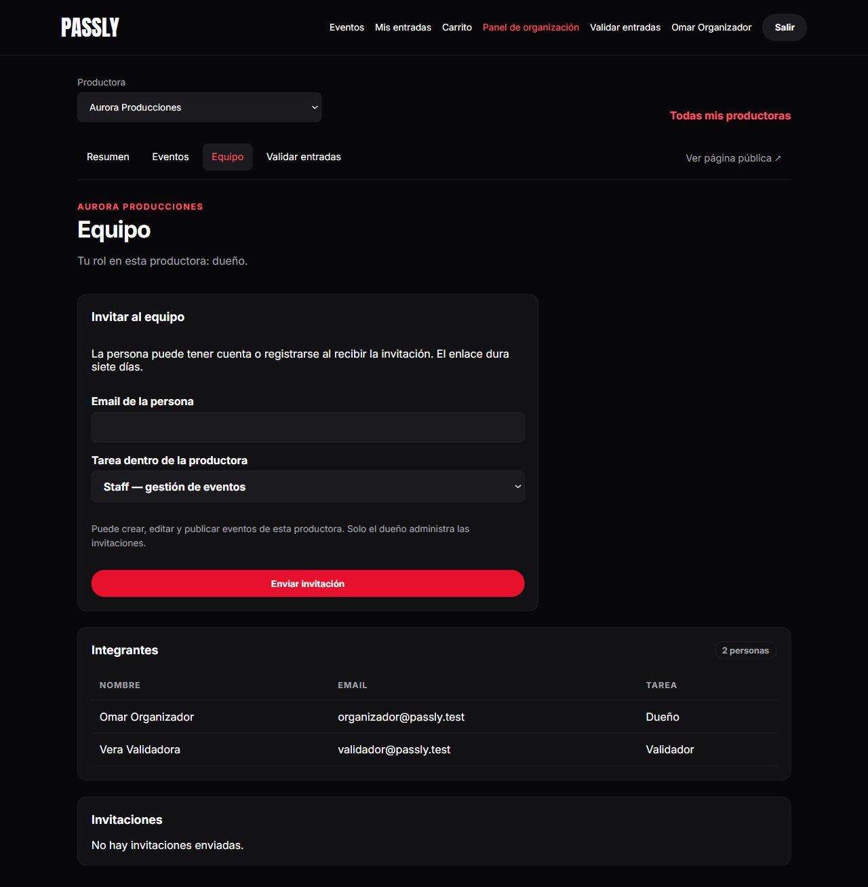

Desde **Invitaciones** podés ver si la invitación ya se aceptó, reenviarla o cancelarla.

---

## 3. Para quien controla el ingreso

Esta pantalla está pensada para usarse **desde el celular** en la puerta del evento.

1. Ingresá con tu cuenta y tocá **Validar entradas** en el menú.
2. Elegí el **evento** que estás controlando.
3. Tocá **Activar cámara** y apuntá al QR de la entrada. Si la cámara no anda, pegá el contenido
   de la entrada en **Ingreso manual del QR** y tocá **Validar entrada**.

   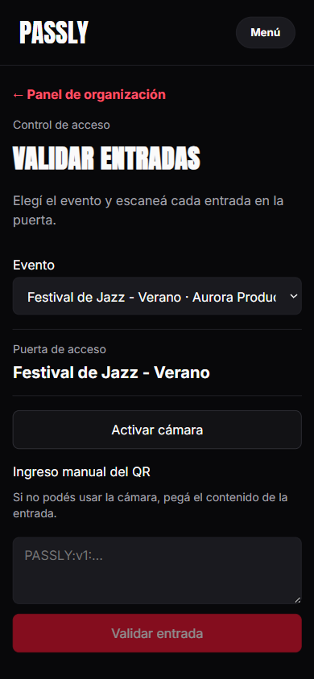

4. La pantalla te dice qué hacer:

| Resultado | Qué significa | Qué hacer |
|---|---|---|
| 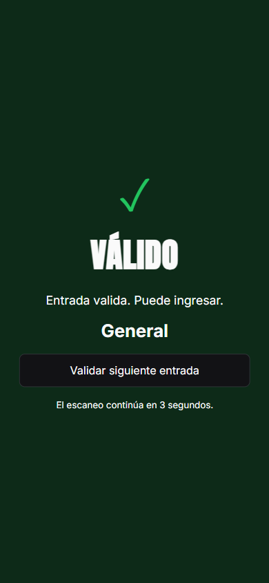 | **Válido**: la entrada es correcta y es la primera vez que se usa | Dejar pasar |
| 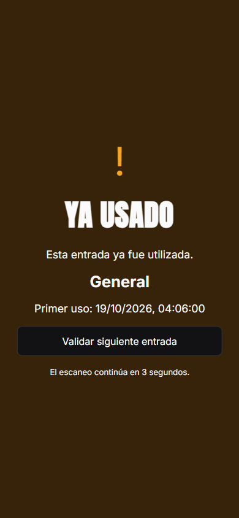 | **Ya usado**: esa entrada ya entró, a la hora indicada | No dejar pasar |
| 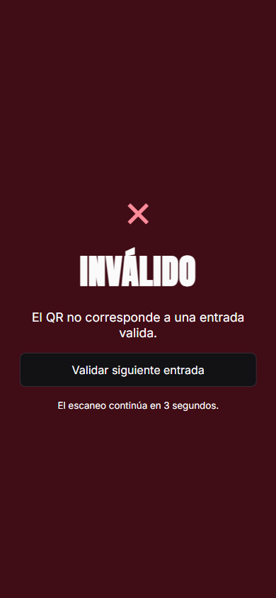 | **Inválido**: el QR no es una entrada de Passly o fue modificado | No dejar pasar |

También puede aparecer **Otro evento**: la entrada es real pero de otra fiesta. Revisá haber
elegido el evento correcto.

5. Después de 3 segundos la pantalla vuelve a escanear sola. También podés tocar **Validar
   siguiente entrada**.

> Solo podés validar eventos de las productoras que te invitaron como validador o staff.

---

## 4. Para el administrador

El administrador da de alta cuentas con permisos especiales. Las cuentas de comprador las crea
cada persona desde el registro.

1. Ingresá y abrí tu nombre en el menú (**Mi perfil**).
2. En **Alta de usuario (admin)**, completá nombre, email y contraseña, y elegí el **rol**:
   organizador, validador o administrador.
3. Tocá **Crear usuario**.

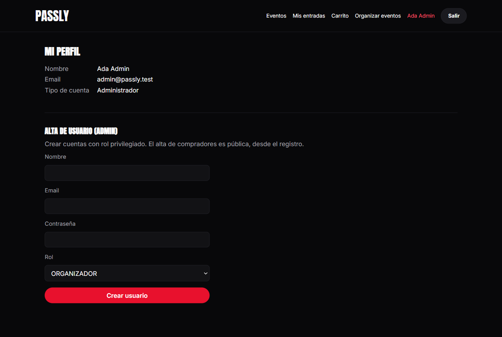

---

## 5. Problemas frecuentes

### "Tu carrito venció"

Tenés **5 minutos** desde que elegís las entradas para pagar. Si pasan, la selección se descarta
y **no se te cobra nada**. Tocá **Volver a elegir entradas** y empezá de nuevo.

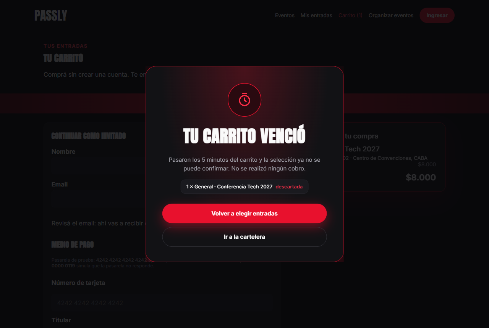

### "El pago fue rechazado"

La tarjeta no fue aprobada. **No se te cobró nada** y tus entradas siguen elegidas: revisá los
datos o probá con otra tarjeta y tocá **Reintentar pago**.

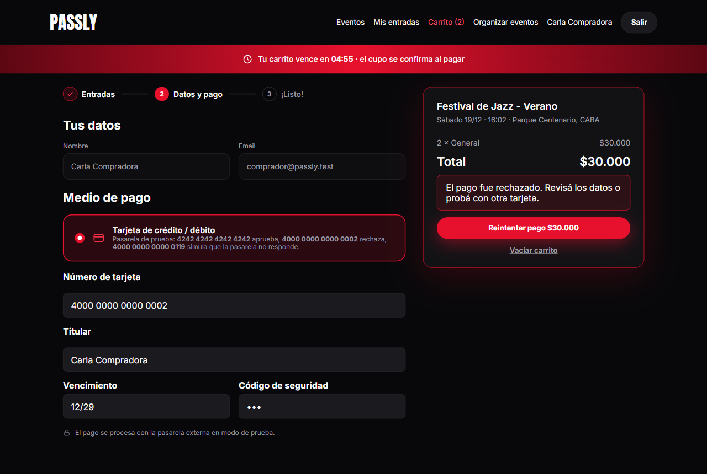

### El pago no responde

Si el servicio de pagos no contesta, Passly te avisa que no está disponible. No se crea ninguna
compra: esperá unos minutos y volvé a intentar.

### En la puerta me dicen "Ya usado"

Cada QR sirve **una sola vez**. Si compraste varias entradas, cada persona tiene que mostrar
**su** QR. Si nunca entraste y aparece "Ya usado", alguien usó una copia de tu entrada:
contactá a la productora con tu número de orden.

### No me llegó el mail de la compra (compra como invitado)

Revisá la carpeta de spam. Si no está, entrá a **Mis entradas** sin iniciar sesión, ingresá el número de orden y el
email de la compra, y pedí un enlace nuevo.

### No me llega la invitación a una productora

Pedile al dueño que revise el email en **Equipo → Invitaciones** y que la reenvíe. Para
aceptarla tenés que ingresar con una cuenta de **ese mismo email**.

### ¿Puedo probar sin gastar dinero?

En este entorno los pagos son de prueba. Usá la tarjeta **4242 4242 4242 4242**, con cualquier
vencimiento futuro y cualquier código de seguridad.
