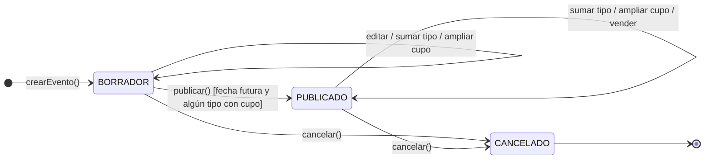

# Passly — Patrones en el dominio (Clase 12, Parte A)

> Relevado sobre `main` (`a42198b`, 15/11/2026): el patrón State quedó implementado en PAS-35 y
> cada patrón tiene su ADR desde PAS-36. Cada afirmación apunta a una clase o test del repo. Los
> ADR completos y su índice están en [`adr/`](adr/README.md).

## 1. Patrones de la consigna, mapeados a Passly

| Patrón (consigna) | MediConecta | LogiRed | StayHub | **Passly** | Estado en el repo |
|---|---|---|---|---|---|
| State | Turno | Envío | Reserva | **Evento:** Borrador → Publicado → Cancelado | ✅ implementado (ADR-006) |
| Strategy | Copago por plan | Transportista | Tarifa por temporada | Precio por tipo de entrada (preventa, general, cortesía) | ⏳ candidato, sin ADR |
| Adapter (legado SOAP) | Obra social | Transportista legado | PMS del hotel | **AFIP** (SOAP) y pasarela de pago (REST) | ✅ REST / 🟡 SOAP con puerto (ADR-004) |
| Observer / pub-sub | TurnoConfirmado → avisos | EnvioEntregado → comercio | ReservaConfirmada → OTA | **OrdenPagada → facturación**; TicketEmitido → mail, accesos | ✅ cola / ⏳ tópico (ADR-008) |

**Patrones elegidos para la entrega (≥3):**

| # | Categoría pedida | Patrón | Dónde | ADR |
|---|---|---|---|---|
| 1 | GoF de comportamiento | **State** | `eventos.internal.datos.EstadoDeEvento` | [ADR-006](adr/ADR-006-state-ciclo-de-vida-del-evento.md) |
| 2 | GoF estructural | **Adapter** (Port & Adapter) | `PasarelaDePago` / `PasarelaDePagoReal`; `ClienteAfip` | [ADR-004](adr/ADR-004-adapter-y-port-proveedores-externos.md) |
| 3 | De integración | **Observer + Point-to-Point / Publish-Subscribe Channel** | `OrdenPagada` → `PublicadorDeOrdenPagada` → cola `orden.pagada` | [ADR-008](adr/ADR-008-observer-pubsub-orden-pagada.md) |
| 4 | GRASP | **Pure Fabrication** (+ Indirection, Protected Variations) | `ConfirmacionDeCompra` | [ADR-009](adr/ADR-009-grasp-pure-fabrication-confirmacion-de-compra.md) |

Ya existentes, con ADR propio: **Facade** (`VentaService`, [ADR-003](adr/ADR-003-facade-servicio-de-ventas.md)),
**DAO** (repositorios Spring Data, [ADR-005](adr/ADR-005-dao-repository-spring-data.md)) y el
componente stateful ([ADR-007](adr/ADR-007-componente-stateful-carrito-session-scope.md)).
**Information Expert** aparece en el propio State: las guardas de publicación viven en el agregado
(`Evento` y sus estados), no en el servicio.

## 2. Entidad central y diagrama de estados

**Entidad central: `Evento`.** Todo el resto del sistema depende de su estado: la cartelera solo
muestra `PUBLICADO`, el detalle público oculta `BORRADOR` (404), solo `PUBLICADO` admite ventas
(`admiteVentas()`), Accesos rechaza ingresos si no está `PUBLICADO` y la edición depende de la
matriz de PAS-19.

Fuente: [`diagramas/estados-evento.mmd`](diagramas/estados-evento.mmd).



| Estado / operación | `publicar()` | `cancelar()` | editar datos / tipo | ampliar (tipo / cupo) | vender |
|---|---|---|---|---|---|
| **BORRADOR** | → PUBLICADO si fecha futura y hay cupo; si no 409 | → CANCELADO | ✅ | ✅ | ❌ |
| **PUBLICADO** | 409 | → CANCELADO | 409 | ✅ | ✅ |
| **CANCELADO** | 409 | 409 | 409 | 409 | ❌ |

`cancelar()` tiene endpoint desde PAS-35 (`POST /api/eventos/{id}/cancelacion`) y botón con
confirmación en la gestión del evento. Reintegros y aviso a compradores quedan fuera de alcance
(HU-14).

### 2.1 Interfaz State con sus transiciones

Fuente: [`diagramas/state-evento-clases.mmd`](diagramas/state-evento-clases.mmd).

```java
// eventos/internal/datos/EstadoDeEvento.java (package-private)
sealed interface EstadoDeEvento permits Borrador, Publicado, Cancelado {
    static EstadoDeEvento de(EstadoEvento estado) {   // único switch sobre el enum
        return switch (estado) {
            case BORRADOR  -> Borrador.INSTANCIA;
            case PUBLICADO -> Publicado.INSTANCIA;
            case CANCELADO -> Cancelado.INSTANCIA;
        };
    }
    EstadoEvento valor();                               // valor persistido
    void publicar(Evento evento);
    void cancelar(Evento evento);
    void editarDatos(Evento evento, ...);
    void agregarTipoEntrada(Evento evento, ...);
    void editarTipoEntrada(Evento evento, ...);
    void ampliarCupo(Evento evento, ...);
    boolean admiteVentas();
}

// Evento.java — el contexto delega en el estado
public void publicar() { comportamiento().publicar(this); }
public void cancelar() { comportamiento().cancelar(this); }
// ...y el estado aplica el cambio con los mutadores package-private pasarA(...), aplicarDatos(...)
```

Decisiones de diseño (detalle en ADR-006):

- **Cada estado decide explícitamente cada operación.** No hay métodos `default` en la interfaz:
  un estado nuevo tiene que responder a todas las operaciones o no compila.
- **El estado aplica el cambio** llamando a los mutadores package-private de `Evento`
  (`pasarA`, `aplicarDatos`, …), que no vuelven a chequear el estado. Por eso viven en el mismo
  paquete.
- **Se persiste el enum, no el objeto.** Contrato, columna `eventos.evento.estado` y API no
  cambian. `sealed` + `switch` exhaustivo: un valor nuevo sin su clase no compila.
- **409 Conflict** para toda operación inválida: `TransicionDeEstadoInvalidaException` (transiciones)
  y `EdicionDeEventoInvalidaException` (ediciones) → `ManejadorDeErrores` → `ProblemDetail` 409.

### 2.2 Bonus: State en el repo con test de transición inválida → 409

| Test | Qué prueba |
|---|---|
| `MatrizDeEstadosDeEventoTest` (unitario, sin Spring) | La matriz completa estado × operación, guardas de publicación, cancelación desde BORRADOR/PUBLICADO, `admiteVentas`, descuento de cupo y resolución enum ↔ clase |
| `CancelacionDeEventoTest` (`@SpringBootTest` + MockMvc) | Cancelar dos veces → 200 y después **409** con `ProblemDetail`; publicar un cancelado → **409**; otra productora no puede cancelar; un cancelado sale de la cartelera |
| `EdicionDeEventoTest`, `DetalleDeEventoTest`, `DescuentoDeCupoTest` y Modulith | El refactor no cambió comportamiento ni fronteras |

## 3. Patrones adicionales — resumen de cada ADR

| Patrón | Problema que resuelve en Passly | Alternativa descartada y por qué |
|---|---|---|
| **State** (ADR-006) | La matriz "qué se puede hacer en cada estado" estaba repartida en `if` sobre el enum | Enum con comportamiento: el enum público pasaría a conocer la entidad interna |
| **Adapter** (ADR-004) | Ventas tenía que cobrar sin conocer el protocolo ni los tipos del proveedor; AFIP es SOAP legado | Llamar al cliente HTTP/SOAP desde el negocio: acopla la compra al proveedor e impedía trabajar en paralelo |
| **Observer + canales** (ADR-008) | Facturar sin frenar ni deshacer la venta, sin arista Ventas → Facturación | Llamada síncrona: AFIP caído = ventas caídas; tópico: factura duplicada |
| **Pure Fabrication** (ADR-009) | Límite transaccional que deja el cobro afuera y cruza tres módulos | `TransactionTemplate` (deja de ser declarativo) o meterlo en `Orden` (no tiene acceso a otros módulos) |

## 4. Auditoría SOLID: una violación real y su refactor

### 4.1 Hallazgo

**Principio violado: SRP (Single Responsibility), con DIP como síntoma secundario.**
**Dónde:** `backend/src/main/java/com/passly/ventas/internal/negocio/CompraInvitadoService.java`,
método `confirmar(clave, nombre, email, tarjeta)` (~50 líneas dentro de un `synchronized`).

Ese único método tiene **siete razones para cambiar**:

| # | Responsabilidad mezclada | Líneas representativas |
|---|---|---|
| 1 | Validar formato de la clave de idempotencia (UUID) | `UUID.fromString(clave)` → `ResponseStatusException(BAD_REQUEST)` |
| 2 | Idempotencia del intento (huella de datos, recuperar respuesta perdida) | `sesion.huellas()`, `intentos.iniciar(...)` |
| 3 | Revalidar cupo y estado de cada evento del carrito | loop sobre `eventos.consultarDisponibilidad` / `consultarEventoPublico` |
| 4 | Calcular vencimiento del enlace privado (último evento + 30 días) | `ultimo.plusDays(30)` |
| 5 | Cobrar con la pasarela | `pasarela.cobrar(total, clave, tarjeta)` |
| 6 | Compensar si la confirmación falla | `pasarela.revertir(...)`, `intentos.fallar(...)` |
| 7 | Traducir errores a HTTP | `ResponseStatusException(CONFLICT / SERVICE_UNAVAILABLE)` |

**Por qué es una violación real y no estética:**

- **Duplicación de la regla de compensación.** Los pasos 5–6 repiten, con otro manejo de errores,
  la lógica de `VentaServiceImpl.confirmarCompra`, con otro manejo de errores: con cuenta, si la
  reversión sale bien se relanza la excepción original (y el status lo decide su handler); como
  invitado, siempre se responde 409. **La misma falla puede producir respuestas distintas** según
  el flujo, y un cambio en la política de reversión hay que hacerlo dos veces.
- **DIP / capas:** una clase de la capa de *negocio* conoce `HttpStatus` y
  `ResponseStatusException` (capa web). No es un caso aislado: el mismo síntoma aparece en
  `VentaServiceImpl`, `ConsultaInvitado`, `IntentosCompra` (ventas) e `InvitacionService`
  (productoras) — 5 clases de `internal/negocio`. Contradice CLAUDE.md §4.5 ("presentación
  traduce HTTP").
- **Testabilidad:** no hay forma de probar la compensación del invitado sin levantar sesión HTTP,
  carrito, pasarela y base.
- Es `public` y depende de **siete** colaboradores concretos.

### 4.2 Refactor propuesto (antes / después)

**Antes** (resumido del código real):

```java
@Service
public class CompraInvitadoService {
    public Confirmada confirmar(String clave, String nombre, String email, DatosDeTarjetaDTO tarjeta) {
        try { UUID.fromString(clave); } catch (IllegalArgumentException e) {
            throw new ResponseStatusException(HttpStatus.BAD_REQUEST, "La clave de intento debe ser un UUID."); }
        synchronized (sesion.candado()) {
            /* huella + idempotencia ............................. (2) */
            /* loop revalidando cupo y fecha del último evento .... (3)(4) */
            ComprobanteDeCobroDTO cobro;
            try { cobro = pasarela.cobrar(total, clave, tarjeta); }                       // (5)
            catch (PagoRechazadoException e) { intentos.fallar(clave); throw e; }
            try { confirmacion.confirmarInvitado(...); }
            catch (RuntimeException e) {                                                  // (6)
                try { pasarela.revertir(cobro.id()); intentos.fallar(clave); }
                catch (RuntimeException compensacion) {
                    throw new ResponseStatusException(HttpStatus.SERVICE_UNAVAILABLE, "..."); } // (7)
                throw new ResponseStatusException(HttpStatus.CONFLICT, "...");
            }
            ...
        }
    }
}
```

**Después** (propuesta):

```java
/** Pure Fabrication compartida: cobrar → confirmar → compensar. Una sola política para ambos flujos. */
@Component
class CobroConCompensacion {
    <T> T cobrarYConfirmar(BigDecimal total, String referencia, DatosDeTarjetaDTO tarjeta,
                           Function<ComprobanteDeCobroDTO, T> confirmar) {
        ComprobanteDeCobroDTO cobro = pasarela.cobrar(total, referencia, tarjeta);
        try {
            return confirmar.apply(cobro);
        } catch (RuntimeException falla) {
            try { pasarela.revertir(cobro.id()); }
            catch (RuntimeException reversion) {
                falla.addSuppressed(reversion);
                throw new CobroPendienteDeRevisionException(cobro.id(), falla);   // excepción de dominio
            }
            throw new CompraRevertidaException(falla);                              // excepción de dominio
        }
    }
}

/** Idempotencia del intento de compra invitada (huellas, recuperación de respuesta perdida). */
@Component class IntentoIdempotente { Optional<Confirmada> recuperar(...); void registrar(...); }

/** Revalidación del carrito contra Eventos; devuelve la fecha del último evento. */
@Component class RevalidacionDeCarrito { OffsetDateTime exigirDisponible(List<ItemDeCarritoDTO> items); }

@Service
class CompraInvitadoService {           // package-private: el contrato es el controller + DTO
    Confirmada confirmar(UUID clave, DatosDeCompraInvitada datos, DatosDeTarjetaDTO tarjeta) {
        synchronized (sesion.candado()) {
            return intento.recuperar(clave, datos).orElseGet(() -> {
                var items  = sesion.carrito().itemsParaConfirmar(INVITADO);
                var ultimo = revalidacion.exigirDisponible(items);
                intento.registrar(clave, datos, items);
                Orden orden = cobro.cobrarYConfirmar(sesion.carrito().total(), clave.toString(), tarjeta,
                        c -> confirmacion.confirmarInvitado(datos, clave, ultimo.plusDays(30), items, c));
                sesion.reiniciar();
                return consultas.consultar(sesion.tokenPara(clave));
            });
        }
    }
}

// ManejadorDeErroresDeVentas (capa web) — único lugar que conoce HTTP
@ExceptionHandler(CompraRevertidaException.class)          ProblemDetail → 409
@ExceptionHandler(CobroPendienteDeRevisionException.class) ProblemDetail → 503
// El formato UUID de la clave lo valida el controller (@RequestHeader UUID) → 400 automático.
```

`VentaServiceImpl.confirmarCompra` pasa a usar el mismo `CobroConCompensacion`, y
`agregarItems` lanza una excepción de dominio (`DisponibilidadCambiadaException`) en vez de
`ResponseStatusException`.

**Comparación:**

| Criterio | Antes | Después |
|---|---|---|
| Responsabilidades en `confirmar` | 7 | 1 (orquestar) |
| Lugares con la política de compensación | 2, con respuestas distintas | 1 (`CobroConCompensacion`) |
| Clases de `ventas/internal/negocio` que usan tipos HTTP | 4 | 2 (se limpian `CompraInvitadoService` y `VentaServiceImpl`; `ConsultaInvitado` e `IntentosCompra` quedan como tarea siguiente) |
| Probar la compensación | Requiere sesión HTTP + base | Unitario con un `PasarelaDePago` falso |
| Visibilidad de `CompraInvitadoService` | `public` | package-private (como el resto de los impl) |
| Contrato HTTP hacia el front | — | **Sin cambios** (mismos 400 / 409 / 503) |

**Estado:** propuesto, no aplicado en esta rama. Se cargó como tarea en el tablero con la
etiqueta `patrones`; aplicarlo exige una red de seguridad previa sobre el flujo invitado
(`AltasInvitadosIntegrationTest` cubre altas y compra feliz, no la compensación).
